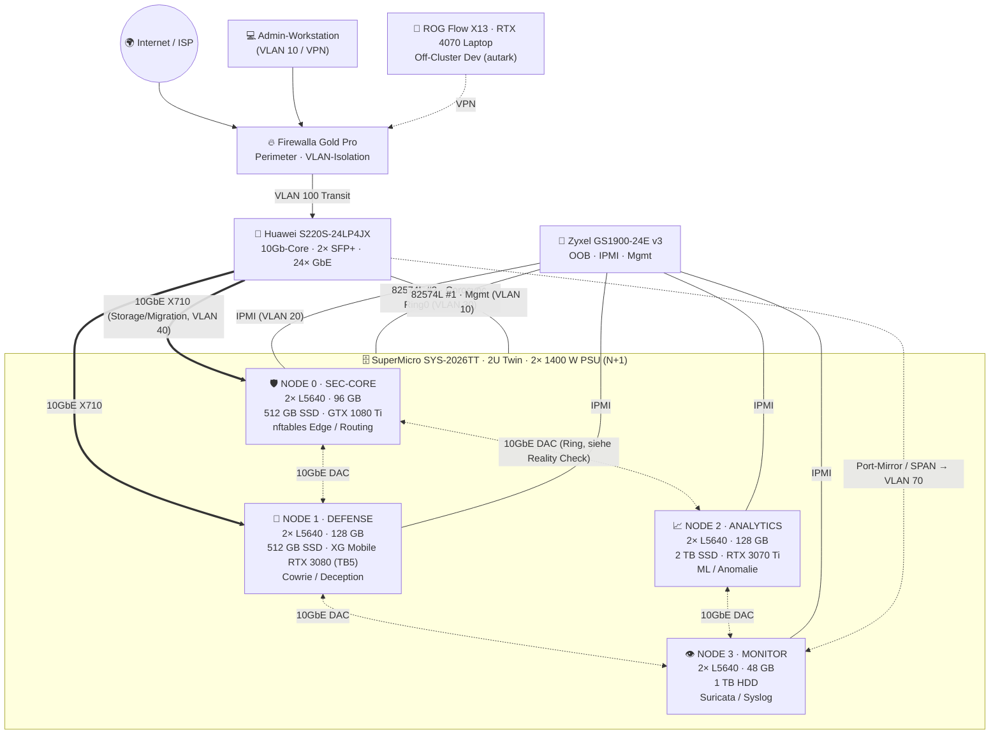
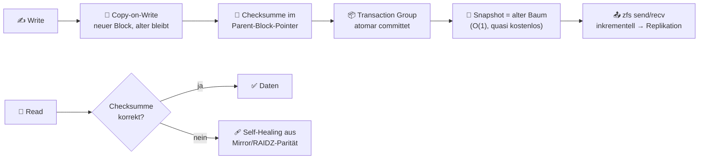
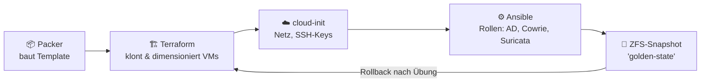
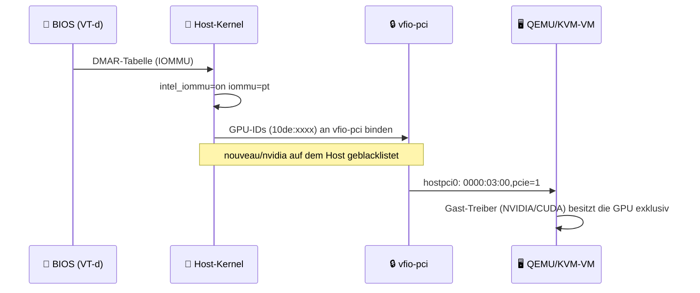

<div align="center">

# 🏛️ The Sovereign Datacenter

### Why Proxmox VE & Recycled Enterprise Hardware Obliterate Consumer Tech & The Cloud Trap

*Ein didaktisches Handbuch und Referenz-Repository für einen souveränen, selbst betriebenen Red-Team- & Security-Lab-Cluster auf recycelter Enterprise-Hardware.*


</div>

---

> [!IMPORTANT]
> **Ehrlichkeits-Versprechen:** Dieses Repository verkauft nichts. Es gibt **keine erfundenen Benchmarks**. Wo Zahlen stehen, sind sie entweder Herstellerangaben, Ergebnisse publizierter Studien (mit Quelle) oder **ausdrücklich als Schätzung/Annahme gekennzeichnet**. Die Referenz-Hardware ist von 2010 (Intel Westmere) – wir sagen klar, was sie kann und was **nicht**. Siehe [🔍 Reality Check](docs/reality-check.md).

## 📚 Inhaltsverzeichnis

- [🗺️ Repository-Struktur](#️-repository-struktur)
- [🖥️ Der Referenz-Cluster](#️-der-referenz-cluster)
- [🌐 Cluster-Topologie (Mermaid)](#-cluster-topologie)
- [⚡ Quickstart](#-quickstart)
- [🧠 Deep Dive 1 – Warum Proxmox VE brillant ist](#-deep-dive-1--warum-proxmox-ve-brillant-ist)
- [🎯 Deep Dive 2 – Use Cases](#-deep-dive-2--use-cases)
- [🏗️ Deep Dive 3 – Langlebigkeit von Enterprise-Hardware](#️-deep-dive-3--langlebigkeit-von-enterprise-hardware)
- [✊ Deep Dive 4 – Manifest: Besitze dein Bare Metal](#-deep-dive-4--manifest-besitze-dein-bare-metal)
- [🔍 Reality Checks (Kurzfassung)](#-reality-checks-kurzfassung)
- [📖 Quellen](#-quellen)
- [📜 Lizenz](#-lizenz)

---

## 🗺️ Repository-Struktur

| Pfad | Inhalt |
|---|---|
| [`docs/architecture.md`](docs/architecture.md) | ZFS-ARC-Sizing, L2ARC/SLOG, PCIe-Topologie & Riser, NUMA/CPU-Pinning, VLAN-Plan, Corosync, Storage-Tiering |
| [`docs/why-enterprise-hardware.md`](docs/why-enterprise-hardware.md) | MTBF/AFR, ECC-Mathematik (SECDED), DRAM-Fehlerraten, TCO vs. Cloud, Anti-Obsoleszenz |
| [`docs/reality-check.md`](docs/reality-check.md) | Alle Plausibilitäts- & Kompatibilitätshinweise zur Referenz-Hardware gesammelt |
| [`docs/reference/`](docs/reference/) | 📄 Original-Hardwarespezifikation des Users ([SM-2026TT-SPEC-V1 PDF](docs/reference/SM-2026TT-SPEC-V1_supermicro-2026tt-red-team-cluster-hardware-spec.pdf)) |
| [`configs/`](configs/README.md) | Beispielkonfigurationen: SDN, VFIO, nftables, Netzwerk, Ansible, Terraform |
| `LICENSE` | MIT (Code/Configs) + CC BY-SA 4.0 (Dokumentation) |
| `CONTRIBUTING.md` | Kurzleitfaden für Beiträge |

---

## 🖥️ Der Referenz-Cluster

> 📄 Quelle: [SM-2026TT-SPEC-V1 – Technische Hardwarespezifikation (PDF)](docs/reference/SM-2026TT-SPEC-V1_supermicro-2026tt-red-team-cluster-hardware-spec.pdf), Standort **Schaan, Liechtenstein**, Status *ACTIVE*.

### 🧱 Chassis, Power & Storage

| Komponente | Spezifikation | Bemerkung |
|---|---|---|
| **Chassis** | SuperMicro **SYS-2026TT** – 2U Twin (Twin²), **4 hot-plug Nodes** | Gemeinsame Lüfter & Netzteile, unabhängige Mainboards |
| **Netzteile** | **2× 1400 W SuperMicro PWS-1K41P-1R** (Platinum), **N+1** | Angegeben: **2'800 W total** ⚠️ siehe [Reality Check](#-reality-checks-kurzfassung) |
| **Spare-PSUs** | **2× PWS-1K41P-1R** identische Ersatzmodule | Sofortige Ausfallreserve |
| **Drive Bays** | **24× 2.5" hot-swap Caddies MCP-220-00047-0B** | **6 pro Node** |
| **CPUs gesamt** | **8× Intel Xeon L5640 @ 2.26 GHz** | **48 Cores / 96 Threads** |
| **RAM gesamt** | **400 GB DDR3 Registered ECC** | 96 + 128 + 128 + 48 = **400 GB** ✅ |
| **NICs pro Node** | **Intel X710** Dual 10GbE SFP+ + **Intel 82574L** Dual 1GbE onboard | X710 als Add-in-Karte |
| **Core-Switch** | **Huawei S220S-24LP4JX** (10Gb-Core) | 24× 1GbE PoE+, 2× 10GE SFP+, 2× 2.5GE SFP |
| **OOB/Mgmt-Switch** | **Zyxel GS1900-24E v3** | Out-of-Band / IPMI / Monitoring |
| **Perimeter** | **Firewalla Gold Pro** | Edge-Schutz, VLAN-Isolation |
| **Hypervisor** | Proxmox VE (laut PDF: **9.2**) | Debian-basiert |

### 🧩 Node-Rollen

| Node | Rolle | CPU | RAM | Storage | GPU / Beschleuniger | Fokus |
|---|---|---|---|---|---|---|
| 🛡️ **NODE 0** | **SEC-CORE** – Firewall / VPC-Gateway | 2× L5640 (12C/24T) | **96 GB** | 512 GB Enterprise SSD (Kingston) | **GTX 1080 Ti 11 GB** via Kolink-Riser | nftables Edge, L3/L4-Filtering, Routing |
| 🍯 **NODE 1** | **DEFENSE** – Honeypot / Deception | 2× L5640 (12C/24T) | **128 GB** | 512 GB Enterprise SSD (Kingston) | **ASUS XG Mobile RTX 3080** eGPU via **TB5-Host-Adapter** (PCIe 4.0 x4 Tunneling, wie angegeben) | Cowrie SSH, Credential Trapping, Real-time Tensor Parsing |
| 📈 **NODE 2** | **ANALYTICS** – ML / Anomalie | 2× L5640 (12C/24T) | **128 GB** | 2 TB SSD (Kingston) | **RTX 3070 Ti 8 GB** via Kolink-Riser (Phase 3, Ziel Dez. 2026) | Traffic-Baseline, Flow-Analyse, DL-Anomalieerkennung |
| 👁️ **NODE 3** | **MONITOR** – IDS / Logging | 2× L5640 (12C/24T) | **48 GB** | 1 TB Seagate Constellation ES HDD | – (Slot bewusst frei) | Suricata DPI, zentrales Syslog; *passiv gekühlt (wie angegeben)* |

### 🛣️ Ausbau-Roadmap (aus dem PDF)

| Phase | Komponenten | Status | Investition (lt. PDF) | Ziel |
|---|---|---|---|---|
| **1** | Cat7-Verkabelung, Proxmox 9.2, Smart Swiss Socket | ✅ Abgeschlossen | ~171–255 CHF | Sep 2026 |
| **2A/B** | TB5-PCIe-Adapter, 2× Kolink-Riser, GPU-Integration | 🟢 Operativ aktiv | 271–281 CHF | Okt 2026 |
| **3** | RTX 3070 Ti, 4× Bulk SAS/SATA-Disks, 10Gb-DAC-Kabel | 🟡 Planung (P1) | 250–400 CHF | Dez 2026 |

> [!WARNING]
> **Stromlast (aus dem PDF übernommen):** Unter Volllast inkl. GPUs erreicht der Cluster **über 1'200 W Peak**. Vor Zuschaltung von Phase 2/3 die Hausinstallation durch eine **Elektrofachkraft** prüfen lassen (thermische Dauerlast, 10 A/16 A-Absicherung, CEE/T13-Verteilung). Keine provisorischen Stromkabelstränge!

---

## 🌐 Cluster-Topologie



> 💡 Der Huawei S220S-24LP4JX hat laut Hersteller-Datenblatt nur **2× 10GE SFP+** – zu wenig für 4 Nodes × 2 X710-Ports. Die gestrichelten DAC-Links zeigen deshalb einen **Ring (Full-Mesh-Light)**. Details: [docs/architecture.md → Netzwerk](docs/architecture.md#-netzwerk-design--vlan-plan).

---

## ⚡ Quickstart

> [!CAUTION]
> Alle Konfigurationen sind **Beispiele mit Platzhaltern** (`<<PLACEHOLDER>>`). Niemals blind auf Produktivsysteme kopieren. Immer zuerst mit IPMI/KVM-Zugang als Fallback arbeiten – eine falsche nftables-Regel sperrt dich sonst aus.

```bash
# 0) Repository holen (lokal – dieses Repo wird bewusst nirgends gepusht)
unzip sovereign-datacenter.zip && cd sovereign-datacenter

# 1) BIOS jedes Nodes (via IPMI-KVM): VT-x, VT-d, ggf. SR-IOV aktivieren; Boot-Mode prüfen
#    (Westmere-Boards booten oft nur Legacy/BIOS → Proxmox-Installer nutzt dann GRUB statt systemd-boot)

# 2) Proxmox VE auf jedem Node installieren (ZFS RAID0 auf Single-Disk oder ext4/LVM-thin)
#    Hostnamen: pve-n0-seccore, pve-n1-defense, pve-n2-analytics, pve-n3-monitor

# 3) Netzwerk: /etc/network/interfaces anhand configs/network/interfaces.example anpassen
ifreload -a

# 4) Cluster bilden – Corosync auf dediziertem 1GbE-Link (VLAN 30), zweiter Link als Fallback
pvecm create sovereign --link0 10.10.30.10 --link1 10.10.40.10     # auf NODE 0
pvecm add 10.10.30.10 --link0 10.10.30.11 --link1 10.10.40.11      # auf NODE 1 (analog N2/N3)
pvecm status

# 5) ZFS-ARC begrenzen (siehe docs/architecture.md)
echo "options zfs zfs_arc_max=8589934592" > /etc/modprobe.d/zfs.conf && update-initramfs -u -k all

# 6) SDN-Zonen & VNets anlegen
bash configs/sdn/pvesh-sdn-setup.sh      # vorher Platzhalter ersetzen!

# 7) GPU-Passthrough (Node 0 / Node 2) vorbereiten
less configs/vfio/README-vfio.md

# 8) Edge-Firewall (in der SEC-CORE-VM oder auf NODE 0)
nft -c -f configs/nftables/edge.nft && nft -f configs/nftables/edge.nft

# 9) Optional: Infrastructure as Code
cd configs/terraform && terraform init && terraform plan
```

---

## 🧠 Deep Dive 1 – Warum Proxmox VE brillant ist

### 🧬 Das Fundament: Debian + KVM + LXC

Proxmox VE ist kein proprietärer Black-Box-Hypervisor, sondern **Debian GNU/Linux** mit einem angepassten Kernel, **KVM/QEMU** für Vollvirtualisierung und **LXC** für Container. Alles, was du über Linux weisst, gilt weiter: `ip`, `nft`, `journalctl`, `perf`, `numactl`, `smartctl`.

| Schicht | Technologie | Was es dir bringt |
|---|---|---|
| 🐧 Basis-OS | Debian (PVE 9.x → Debian 13 „Trixie“) | Stabile Pakete, riesige Community, `apt` |
| 🖥️ Vollvirtualisierung | KVM + QEMU | Beliebige Gast-OS (Windows AD, BSD, Linux), PCIe-Passthrough |
| 📦 Container | LXC | Sehr geringer Overhead für Linux-Dienste (Syslog, Cowrie, Grafana) |
| 💾 Storage | ZFS, LVM-thin, Ceph, NFS, iSCSI | Freie Wahl, kein proprietäres Datastore-Format |
| 🔗 Cluster | Corosync + pmxcfs | Multi-Master, kein separater „vCenter“-Server nötig |
| 🌐 Netzwerk | Linux Bridge, OVS, SDN (VLAN/VXLAN/EVPN) | Software-defined Networking ohne Zusatzlizenz |
| 🔌 API | REST-API + `pvesh` | Alles, was die GUI kann, kann auch Code |

### 💾 ZFS – das Dateisystem, das dich nicht anlügt



- 🐄 **Copy-on-Write (CoW):** Daten werden nie „in place“ überschrieben. Ein Stromausfall mitten im Schreiben hinterlässt einen konsistenten alten *oder* neuen Zustand – keinen halben.
- 🔐 **End-to-End-Checksummen** (Standard `fletcher4`, optional `sha256`/`blake3`): Jeder Block wird beim Lesen verifiziert. Silent Data Corruption („Bit Rot“) wird **erkannt** – und mit Redundanz (Mirror/RAIDZ) **automatisch repariert**.
- 🧹 **Scrub:** `zpool scrub rpool` liest periodisch *alle* Daten und prüft Checksummen. Debian/Proxmox planen standardmässig einen monatlichen Scrub ein.
- 📸 **Snapshots:** Atomar und nahezu sofort. Perfekt vor riskanten Aktionen (siehe Exploitation-Runs unten).
- 🔁 **Replikation:** Proxmox-Storage-Replication nutzt `zfs send/receive` inkrementell zwischen Nodes – asynchrone Replikation im Minutentakt ohne Shared Storage.
- 🗜️ **Kompression:** `lz4` (Default) oder `zstd`. Spart Platz *und* oft I/O, weil weniger Bytes physisch geschrieben werden.
- 🧮 **Deduplikation:** Vorhanden, aber **RAM-hungrig** (Dedup-Tabelle). Faustregel: Für dieses Lab **aus lassen** – Kompression bringt fast immer mehr pro GB RAM. OpenZFS 2.3 bringt „Fast Dedup“, das die Lage verbessert, aber nicht kostenlos macht.

> [!NOTE]
> ZFS ersetzt **kein Backup**. Ein Single-Disk-Pool (wie auf jedem Node dieses Clusters) **erkennt** Korruption, kann sie aber ohne Redundanz nicht selbst heilen (ausser bei Metadaten, die ZFS mehrfach speichert, oder mit `copies=2`). → Deshalb PBS (unten).

### 🔗 Corosync & pmxcfs – das Cluster-Gehirn

- **Corosync** liefert Cluster-Membership und Messaging mit **Totem-Protokoll** über **kronosnet (knet)**, mit bis zu 8 redundanten Links. Es ist **latenzempfindlich** (Proxmox empfiehlt einen dedizierten, latenzarmen Link) – nicht Bandbreiten-hungrig.
- **pmxcfs** („Proxmox Cluster File System“) ist unter `/etc/pve` gemountet: ein **FUSE**-Dateisystem, dessen Inhalt in einer **SQLite-Datenbank** (`/var/lib/pve-cluster/config.db`) persistiert und via Corosync auf alle Nodes **repliziert** wird. Jede VM-Konfig, jede Firewall-Regel, jede SDN-Definition ist damit sofort clusterweit verfügbar.
- **Quorum:** Schreibzugriffe auf `/etc/pve` erfordern Mehrheit. Bei **4 Nodes** droht ein 2:2-Split → empfohlen: **QDevice** (`corosync-qnetd` auf einem externen Kleinstgerät) als 5. Stimme.

### 🐙 Ceph – optional, wenn die Disks kommen

Proxmox integriert **Ceph** (RBD für VM-Disks, CephFS) inkl. GUI-Deployment. Ceph braucht **mind. 3 Nodes**, sinnvollerweise **mehrere OSDs pro Node** und ein **schnelles, dediziertes Netz (≥10GbE)**. Im aktuellen Ausbau (1 Disk/Node, gleichzeitig Boot-Disk) ist Ceph **nicht sinnvoll**; mit Phase 3 (4× Bulk SAS/SATA-Disks) wird ein kleiner Ceph-Pool zum Lernen realistisch. Bis dahin: **ZFS + Storage-Replication**.

### 🔓 Kein VMware/Broadcom-Lock-in

Nach der Übernahme von VMware durch Broadcom (Abschluss Nov. 2023) wurden u. a. unbefristete Lizenzen eingestellt, auf Abo-Bundles umgestellt und der kostenlose ESXi-Hypervisor zunächst eingestellt (Feb. 2024; später in eingeschränkter Form wieder angeboten). Für Homelabs und KMU bedeutete das Unsicherheit und teils massive Kostensteigerungen.

| Kriterium | Proxmox VE | Proprietärer Hypervisor (typisch) |
|---|---|---|
| Lizenz | **AGPLv3**, kostenlos nutzbar | Proprietär, Abo |
| Subscription | Optional (Enterprise-Repo + Support) | Pflicht für Betrieb/Updates |
| Cluster-Management | Eingebaut | Separater Management-Server |
| Datenformate | Offen (qcow2, raw, ZFS zvol) | Proprietär (VMFS, vmdk) |
| Hardware-Kompatibilität | Was Linux kann (inkl. „alter“ HW) | HCL, alte CPUs fallen aus dem Support |
| Exit-Strategie | `qm` exportieren, Disks sind Standard | Migration aufwendig |

> ♻️ Besonders relevant für diesen Cluster: Neuere proprietäre Hypervisor-Releases unterstützen Westmere-CPUs längst nicht mehr. **Linux/KVM tut es weiterhin.**

### 🤖 API & Infrastructure as Code

| Tool | Einsatz | Beispiel im Repo |
|---|---|---|
| `pvesh` / REST-API | Alles skriptbar, Token-basiert | [`configs/sdn/pvesh-sdn-setup.sh`](configs/sdn/pvesh-sdn-setup.sh) |
| **Terraform / OpenTofu** | VMs/LXC deklarativ (z. B. Provider `bpg/proxmox`) | [`configs/terraform/`](configs/terraform/) |
| **Ansible** | Host-Konfiguration, Hardening, Pakete | [`configs/ansible/`](configs/ansible/) |
| **Packer** | Goldene Templates (Windows Server, Kali, Ubuntu) via `proxmox-iso` Builder | (Konzept, siehe unten) |
| **cloud-init** | Erstkonfiguration geklonter VMs | in Terraform-Beispiel |



---

## 🎯 Deep Dive 2 – Use Cases

### 🔴 Red-Team- & Threat-Simulation-Labs

| Szenario | Umsetzung auf dem Cluster | Proxmox-Feature |
|---|---|---|
| **AD-Forests** (Multi-Domain, Trusts, ADCS) | Windows-Server-VMs auf NODE 1/2, isoliert in VNet `lab` | Templates + Linked Clones |
| **Angriffsketten üben** (Kerberoasting, Relay, Lateral Movement) | Angreifer-VM (Kali) + Opfer-Netz, Egress gesperrt | SDN-VNet ohne Gateway |
| **Honeypots** | Cowrie (SSH/Telnet), weitere Low/Medium-Interaction-Honeypots in DMZ-VLAN | LXC, Firewall-Gruppen |
| **Blue-Team-Gegenstück** | Suricata + Syslog-Sink auf NODE 3 sieht alles via SPAN | VLAN-Mirror, Bridges |
| **Malware-Detonation** (nur mit Know-how!) | Komplett air-gapped VNet, kein Routing, Snapshots | Isolierte Bridge ohne Uplink |

> 📸 **Golden Rule – Snapshot vor jedem Exploitation-Run:**
> ```bash
> qm snapshot 210 pre-exploit-$(date +%F-%H%M) --description "vor PrintNightmare-Lab"
> # ... Übung ...
> qm rollback 210 pre-exploit-2026-10-13-0300
> ```
> ZFS-Snapshots sind in Sekunden erstellt und zurückgerollt – kein Neuaufsetzen der Domäne nach jeder Übung.

> [!CAUTION]
> Offensive Techniken **nur in eigenen, isolierten Umgebungen** oder mit **schriftlicher Autorisierung** einsetzen. Honeypots, die Angreifer-Traffic annehmen, müssen so isoliert sein, dass ein kompromittierter Honeypot **nicht** als Sprungbrett ins eigene Netz oder gegen Dritte dient (Egress-Filter!). Rechtslage (FL/CH/EU: Datenschutz, Logging von Fremd-IPs) beachten.

### 🌐 SDN – VLAN, VXLAN, EVPN

| Zonentyp | Prinzip | Wann einsetzen |
|---|---|---|
| **Simple** | Isolierte Bridge pro Node, optional NAT/DHCP | Schnelle Labs auf einem Node |
| **VLAN** | 802.1Q-Tags über eine VLAN-aware Bridge | Standard für dieses Lab (Switch kann VLANs) |
| **QinQ** | Gestapelte VLANs | Mandantenfähigkeit |
| **VXLAN** | L2 über L3 (UDP 4789), Overlay | Lab-Netze über Node-Grenzen ohne Switch-Konfig |
| **EVPN** | VXLAN + BGP-Control-Plane (FRR), Anycast-Gateway | Fortgeschritten: verteiltes Routing, „Mini-VPC“ |

Unter der Haube: **Linux Bridge** (Default, VLAN-aware) oder **Open vSwitch**, Filterung via **Proxmox-Firewall** (nftables-Backend `proxmox-firewall` in PVE 8.2+ als Opt-in verfügbar) bzw. eigener **nftables**-Regeln. Beispiele: [`configs/sdn/`](configs/sdn/), [`configs/nftables/`](configs/nftables/).

### 🎮 GPU – VFIO-Passthrough, vGPU, ML



| Technik | Was | Status in diesem Cluster |
|---|---|---|
| **VFIO-Passthrough** | Ganze GPU exklusiv an **eine** VM | ✅ Haupt-Weg (NODE 0, NODE 2) – mit Westmere-Caveats |
| **NVIDIA vGPU** | GPU auf mehrere VMs teilen | ❌ Offiziell nur Datacenter-GPUs + Lizenz; GeForce nicht unterstützt (Community-Hacks existieren, nicht empfohlen) |
| **SR-IOV (NIC)** | X710 Virtual Functions direkt an VMs | ✅ Sinnvoll für Firewall-/Sensor-VMs |
| **LXC + GPU** | Device-Nodes in Container durchreichen | ✅ Alternative für CUDA-Workloads ohne VM |
| **eGPU via TB5** | Externe GPU über Thunderbolt-Tunneling | 🧪 **Experimentell** – siehe Reality Check |

**ML auf diesem Cluster – ehrlich:** Die GPUs übernehmen die Rechenlast (CUDA), die Westmere-CPUs bremsen aber Datenvorverarbeitung und Teile der Software-Stacks. L5640 hat **kein AVX und kein AVX2** (AVX kam erst mit Sandy Bridge 2011). Vorgebaute **TensorFlow**-Binaries setzen seit v1.6 AVX voraus; andere Pakete (z. B. manche Wheels von NumPy-Erweiterungen, ONNX-Runtimes, Vektor-DBs) können ebenso AVX/AVX2 voraussetzen. Bei **PyTorch** und **CUDA** selbst ist die Lage besser, muss aber **pro Version getestet** werden. → Lösungen: aus Source bauen, Container mit passenden Builds, CPU-lastige Vorverarbeitung auf den Off-Cluster-Laptop (RTX 4070) auslagern.

### 🗄️ Proxmox Backup Server (PBS)

| Eigenschaft | Bedeutung |
|---|---|
| **Inkrementell** | Nur geänderte Chunks; für VMs mit **Dirty-Bitmap** – nach dem ersten Lauf sehr schnell |
| **Dedupliziert** | Content-addressed Chunks (SHA-256) – identische Daten über alle Backups/VMs nur einmal |
| **Client-seitig verschlüsselt** | AES-256-GCM **vor** dem Upload; der Backup-Server sieht nur Chiffrat |
| **Verifikation** | Geplante Verify-Jobs prüfen Chunk-Integrität |
| **Sync/Remote** | Offsite-Kopie auf zweiten PBS (z. B. bei Freunden/Familie → 3-2-1-Regel) |

> 💡 PBS kann als VM/LXC laufen, sollte aber idealerweise **nicht auf demselben Chassis** liegen wie die gesicherten VMs (gemeinsame Netzteile/Backplane = gemeinsamer Fehlerpunkt).

---

## 🏗️ Deep Dive 3 – Langlebigkeit von Enterprise-Hardware

> Ausführlich mit Mathematik und Quellen: **[docs/why-enterprise-hardware.md](docs/why-enterprise-hardware.md)**

| Merkmal | Enterprise (z. B. SYS-2026TT) | Consumer-Desktop/NUC | Warum es zählt |
|---|---|---|---|
| ⏱️ **Auslegung** | 24/7-Dauerbetrieb, Server-Kondensatoren, definierte Airflow | Oft 8/5-Nutzungsprofil | Thermischer Stress über Jahre |
| 🔌 **Netzteile** | Redundant, **hot-swap**, PMBus-Telemetrie | Einzel-PSU | PSU-Ausfall ≠ Downtime |
| 🔥 **Hot-Swap** | Disks, PSUs, ganze **Nodes** | – | Wartung ohne Herunterfahren |
| 🧠 **RAM** | **ECC Registered** (RDIMM), SDDC/Chipkill-Varianten | Meist Non-ECC UDIMM | Bit-Flips werden korrigiert statt still verteilt |
| 📈 **RAM-Kapazität** | bis **192 GB pro Node** (12 Slots, Herstellerangabe) | 64–128 GB typisch | Viele VMs/AD-Forests |
| 🛣️ **PCIe** | Dual-Socket = mehr Lanes, Server-Riser | Wenige Lanes | NICs/GPUs/HBAs |
| 💽 **Storage** | SAS/SATA-Backplane, Hot-Swap-Caddies (bei neueren Plattformen NVMe/U.2) | M.2 | Austausch im Betrieb |
| 🌐 **NIC** | Intel X710: 10GbE SFP+, **SR-IOV**, Offloads | 1/2.5GbE Realtek | Echte Netzlabore |
| 🧰 **OOB** | **IPMI/BMC** mit KVM-over-IP | – | Remote-Rettung bei Fehlkonfiguration |
| 💸 **Gebraucht-Preis** | Bruchteil des Neupreises (Refurb-Markt) | – | Grosser Hebel für die TCO |

**MTBF vs. AFR (Kurzfassung):** Eine MTBF von 2'000'000 h bedeutet **nicht** „228 Jahre Lebensdauer“, sondern eine **erwartete jährliche Ausfallrate** von ≈ 1 − e^(−8760/2'000'000) ≈ **0,44 %** innerhalb der Nutzungsdauer. Feldstudien (Schroeder & Gibson, FAST '07; Backblaze Drive Stats) zeigen reale Raten, die oft **über** den Datenblattwerten liegen → Redundanz und Monitoring schlagen Marketing-Zahlen.

**Ehrliche Grenzen dieser Plattform (Westmere-EP, 2010):**

| Limit | Auswirkung | Mitigation |
|---|---|---|
| ⚡ **Leistungsaufnahme** | Viel Watt pro Rechenleistung verglichen mit modernen CPUs (L5640: 60 W TDP, aber 32-nm-Ära) | Ungenutzte Nodes per IPMI abschalten, `powertop`/C-States, GPUs nur bei Bedarf |
| 🧮 **Kein AVX/AVX2** | Manche ML-Stacks/Binaries laufen nicht | Source-Builds, GPU-Offload, Off-Cluster-Dev |
| 🛣️ **PCIe 2.0** | ~500 MB/s pro Lane und Richtung; x16 ≈ 8 GB/s | Für Inferenz oft ok, für Datentransfer-lastiges Training Flaschenhals |
| 🔒 **IOMMU-Alter** | VT-d der 5520-Generation, bekannte Interrupt-Remapping-Errata | Siehe [VFIO-README](configs/vfio/README-vfio.md) |
| 💾 **DDR3** | Langsamer, aber gebraucht sehr günstig | Kanäle symmetrisch bestücken |
| 🔐 **Firmware** | BIOS-Updates seit Jahren eingestellt; Spectre/Meltdown-Microcode nur teilweise | Nicht als Internet-exponierte Prod-Plattform für Fremddaten betreiben |

---

## ✊ Deep Dive 4 – Manifest: Besitze dein Bare Metal

> *„Die Cloud ist nur der Computer von jemand anderem.“* – Bekanntes Sprichwort der Admin-Community

1. 🏛️ **Souveränität.** Wer die Hardware besitzt, bestimmt über Updates, Lebensdauer, Standort und Exit. Kein Anbieter kann über Nacht Preise verdreifachen, Produkte einstellen oder Accounts sperren.
2. 🔏 **Privatsphäre.** Logs, PCAPs, Honeypot-Credentials und Malware-Samples sind **sensibel**. Auf eigener Hardware in Schaan unterliegen sie deiner Kontrolle – nicht den AGB und Rechtsräumen eines Hyperscalers.
3. 🧠 **Echte Ingenieurskunst.** Die Cloud abstrahiert genau das weg, was Security-Leute verstehen müssen: IOMMU-Gruppen, NUMA, ARP, VLAN-Tagging, Bit-Flips, Stromlast, Airflow. Ein Homelab ist der beste Lehrer, weil es **zurückschlägt**.
4. ♻️ **Nachhaltigkeit durch Weiterbetrieb.** Jedes weiterbetriebene Gerät ist eines, das nicht als Elektroschrott endet und nicht neu produziert werden muss (Herstellungsemissionen). *Ehrlich:* Diese Rechnung wird durch den höheren Stromverbrauch alter Hardware teilweise aufgezehrt – darum bewusst dimensionieren und abschalten, was nicht läuft.
5. 💰 **Planbare Kosten.** Einmal kaufen, Strom zahlen, fertig – keine Egress-Gebühren, keine Überraschungsrechnung durch eine vergessene GPU-Instanz.
6. 🤝 **Offenheit.** Offene Software (AGPL/GPL), offene Formate, offene Doku – Wissen, das man teilt (dieses Repo: MIT + CC BY-SA).

> ⚖️ **Fairness:** Die Cloud hat legitime Stärken – globale Verfügbarkeit, Elastizität, Managed Services, keine Hardware-Wartung. Das Manifest richtet sich gegen **unreflektierte Abhängigkeit**, nicht gegen die Cloud als Werkzeug. Für ein Security-Lab mit Dauerlast und sensiblen Daten spricht allerdings sehr viel für eigenes Metall.

---

## 🔍 Reality Checks (Kurzfassung)

Die Spezifikation wird **unverändert** dokumentiert. Die folgenden Hinweise sind respektvoll gemeint – sie sollen Hardware, Gesundheit und Brandschutz schützen. Volle Version mit Begründungen: **[docs/reality-check.md](docs/reality-check.md)**.

| # | Thema | Kurzfassung |
|---|---|---|
| RC-1 | ⚡ **2'800 W „total“** | Bei **N+1** liefert das System dauerhaft nur so viel, wie **ein** Netzteil kann (≈1'400 W, abhängig von Eingangsspannung). 2'800 W ist Summe der Typenschilder, nicht nutzbare Leistung. |
| RC-2 | 🔥 **250–285 W GPUs in einem 2U-Twin-Node** | Die Nodes haben **einen** PCIe-2.0-x16-Low-Profile-Slot und keine GPU-Stromstecker. Dual-Slot-Karten passen nicht ins Gehäuse → GPU **extern** via Riser, **separate** ATX-PSU, eigene Kühlung. Herstellerangabe RTX 3070 Ti: 290 W Board Power. |
| RC-3 | 🧩 **Ein Slot pro Node** | X710 **und** GPU-Riser konkurrieren um denselben x16-Slot. Bifurcation wird von X8-Generation-BIOS typischerweise nicht angeboten → pro Node entweder 10GbE **oder** GPU (oder gezielt prüfen). |
| RC-4 | 🔌 **TB5 auf Westmere** | Westmere-Boards haben weder Thunderbolt-Controller noch TB-Header/Firmware-Support. TB5-Add-in-Adapter sind hier **experimentell**. Zudem: Das **XG Mobile GC31 (RTX 3080)** nutzt laut ASUS eine **proprietäre PCIe 3.0 x8**-Schnittstelle, kein Thunderbolt → Kompatibilität mit einem TB5-Host-Adapter ist **fraglich**. Effektiv limitiert der PCIe-2.0-Host-Slot. |
| RC-5 | ❄️ **„Passiv gekühlter“ NODE 3** | Im Twin-Chassis haben **alle** Nodes passive CPU-Kühlkörper, gekühlt durch die **gemeinsamen** Chassis-Lüfter. Ein Node ist nicht thermisch unabhängig; ein leerer Slot entlastet die Kühlung (so im PDF begründet), Luftführung/Blenden müssen trotzdem vollständig sein. |
| RC-6 | 🧠 **RAM-Bestückung** | Laut SuperMicro hat jeder X8DTT-Node **12 DIMM-Slots** (max. 192 GB RDIMM). Das PDF nennt 16× 8 GB (128 GB) bzw. „6 Slots frei“ bei 12 DIMMs – das passt nicht zu 12 Slots. 128 GB → z. B. 8× 16 GB. Gesamtsumme 400 GB bleibt korrekt. |
| RC-7 | 🔀 **Nur 2× 10GE am Core-Switch** | 8 X710-Ports, aber 2 SFP+-Ports am S220S → Ring/Mesh mit DAC oder Switch-Upgrade. |
| RC-8 | 🧰 **„iLO“** | iLO ist HPEs BMC; SuperMicro nutzt **IPMI 2.0/BMC**. Funktional gleiche Rolle. |
| RC-9 | 📊 **eGPU-Daten** | ASUS nennt für das XG Mobile GC31 mit RTX 3080 **16 GB GDDR6** und bis **150 W**; das PDF nennt 8 GB/140 W (das sind eher die Werte der RTX-3070-Variante). Bitte am Gerät verifizieren. |

---

## 📖 Quellen

| Thema | Quelle |
|---|---|
| Proxmox VE Doku (pmxcfs, Corosync, SDN, ZFS, PCI-Passthrough) | <https://pve.proxmox.com/pve-docs/> · <https://pve.proxmox.com/wiki/PCI_Passthrough> |
| Proxmox Backup Server | <https://pbs.proxmox.com/docs/> |
| OpenZFS Doku & Modulparameter | <https://openzfs.github.io/openzfs-docs/> |
| DRAM-Fehler im Feld | Schroeder, Pinheiro, Weber: *DRAM Errors in the Wild: A Large-Scale Field Study*, SIGMETRICS 2009 |
| Disk-Ausfallraten | Schroeder & Gibson: *Disk failures in the real world*, USENIX FAST 2007 · Backblaze Drive Stats |
| SuperMicro X8DTT / 2026TT | SuperMicro Manuals MNL-1266 / X8DTT (12 DIMM-Slots, 1× PCIe 2.0 x16 pro Node) |
| Intel Xeon L5640 | Intel ARK (Westmere-EP, 6C/12T, 2.26 GHz, 60 W TDP, AES-NI, kein AVX) |
| Huawei S220S-24LP4JX | Huawei Hardware Description / Datenblatt (24× GE PoE+, 2× 10GE SFP+, 2× 2.5GE SFP) |
| ASUS ROG XG Mobile GC31 | <https://rog.asus.com/external-graphics-docks/2021-rog-xg-mobile-model/spec/> |
| Referenz-Spezifikation (User) | [docs/reference/SM-2026TT-SPEC-V1 PDF](docs/reference/SM-2026TT-SPEC-V1_supermicro-2026tt-red-team-cluster-hardware-spec.pdf) |

---

## 📜 Lizenz

- 🧑‍💻 **Code & Konfigurationen** (`configs/`, Skripte): **MIT** – siehe [LICENSE](LICENSE)
- 📝 **Dokumentation** (`README.md`, `docs/`): **CC BY-SA 4.0**
- 📄 Die Referenz-PDF in `docs/reference/` ist Eigentum des Autors der Spezifikation und von den obigen Lizenzen ausgenommen.

<div align="center">

**🏛️ Own the metal. Understand the stack. Trust nothing you can't inspect.**

</div>
