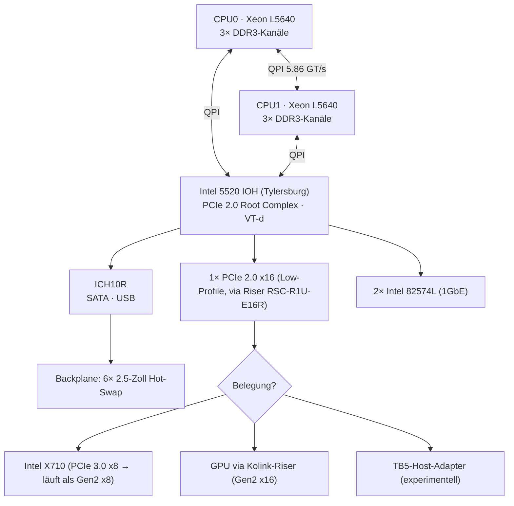
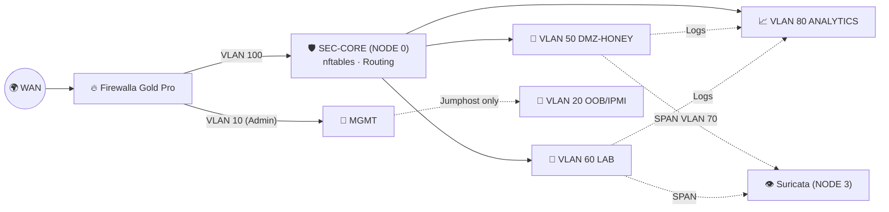
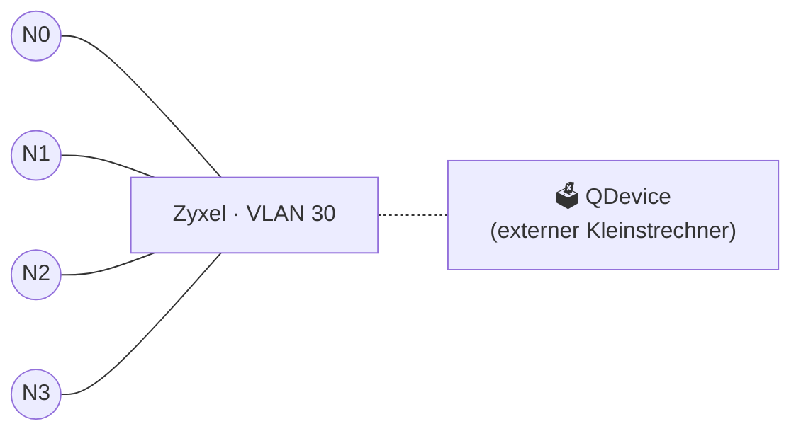
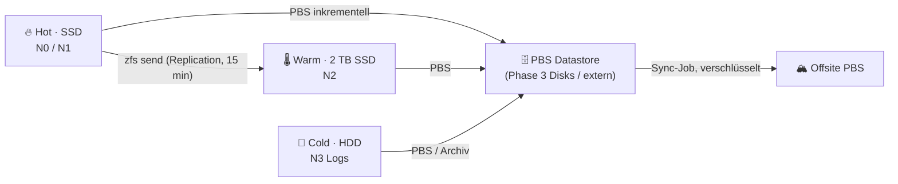

# 🏗️ Architektur – Sovereign Datacenter Cluster

> 📄 Basis: [SM-2026TT-SPEC-V1 (PDF)](reference/SM-2026TT-SPEC-V1_supermicro-2026tt-red-team-cluster-hardware-spec.pdf) · Zurück zur [README](../README.md) · Siehe auch [Reality Check](reality-check.md)

> [!NOTE]
> Alle Werte in diesem Dokument sind **Empfehlungen/Startpunkte**, keine gemessenen Benchmarks. Nach jeder Änderung selbst messen (`arc_summary`, `numastat`, `iperf3`, `fio`).

## 📚 Inhalt

1. [ZFS: ARC-Sizing](#-zfs-arc-sizing)
2. [L2ARC & SLOG](#-l2arc--slog)
3. [PCIe-Topologie, Bifurcation & Riser](#-pcie-topologie-bifurcation--riser)
4. [NUMA auf Dual-Socket Westmere](#-numa-auf-dual-socket-westmere)
5. [Netzwerk-Design & VLAN-Plan](#-netzwerk-design--vlan-plan)
6. [Corosync auf dediziertem Link](#-corosync-auf-dediziertem-link)
7. [Storage-Tiering pro Node](#-storage-tiering-pro-node)

---

## 🧠 ZFS: ARC-Sizing

Der **ARC** (Adaptive Replacement Cache) ist der RAM-Cache von ZFS. Er kombiniert MRU- und MFU-Listen und ist der Hauptgrund, warum ZFS „schnell trotz CoW“ ist. Auf einem Hypervisor konkurriert er aber **direkt mit dem RAM der VMs**.

| Parameter | Bedeutung | Default |
|---|---|---|
| `zfs_arc_max` | Obergrenze des ARC (Bytes) | OpenZFS/Linux: 50 % RAM; **Proxmox-Installer (ab PVE 8.1)**: 10 % RAM, max. 16 GiB bei Neuinstallation |
| `zfs_arc_min` | Untergrenze; ARC schrumpft nicht darunter | dynamisch (klein) |
| `zfs_arc_sys_free` | RAM, den ZFS dem System freihalten will | dynamisch |

**Faustformel (Startpunkt, kein Gesetz):**

```
ARC_max ≈ 2 GiB Basis + 1 GiB pro TiB Pool-Kapazität   (für reine VM-Hosts)
         → nach oben begrenzen, damit Summe(VM-RAM) + ARC + ~4–8 GiB Host < physischer RAM
```

### 📋 Empfehlung pro Node

| Node | RAM | Pool | Vorgeschlagenes `zfs_arc_max` | Bytes | Begründung |
|---|---|---|---|---|---|
| 🛡️ NODE 0 | 96 GB | 512 GB SSD | **4 GiB** | `4294967296` | Firewall-VMs brauchen wenig Cache; RAM für VMs |
| 🍯 NODE 1 | 128 GB | 512 GB SSD | **6 GiB** | `6442450944` | Viele kleine Honeypot-LXCs, AD-Lab-VMs |
| 📈 NODE 2 | 128 GB | 2 TB SSD | **8 GiB** | `8589934592` | Datasets für ML, wiederholte Reads profitieren |
| 👁️ NODE 3 | 48 GB | 1 TB HDD | **6 GiB** | `6442450944` | HDD profitiert am meisten vom Cache (Syslog-Suchen) |

```bash
# Persistent (wirkt nach Reboot)
echo "options zfs zfs_arc_max=8589934592" > /etc/modprobe.d/zfs.conf
# optional: Untergrenze
echo "options zfs zfs_arc_min=2147483648" >> /etc/modprobe.d/zfs.conf
update-initramfs -u -k all      # nötig, wenn root auf ZFS liegt

# Sofort zur Laufzeit (ARC schrumpft ggf. erst verzögert)
echo 8589934592 > /sys/module/zfs/parameters/zfs_arc_max

# Kontrolle
arc_summary | less
awk '/^size|^c_max|^hits|^misses/ {print}' /proc/spl/kstat/zfs/arcstats
```

> ⚠️ `zfs_arc_max` muss **grösser** als `zfs_arc_min` sein, sonst wird es ignoriert.

### 🗜️ Dataset-Tuning

```bash
zfs set compression=lz4 rpool          # Default auf PVE; zstd für Log-Archive
zfs set atime=off rpool                # weniger Schreib-I/O
zfs set compression=zstd-3 rpool/data/syslog-archive   # NODE 3 (Platzhalter-Dataset)
zfs get dedup rpool                    # sollte 'off' sein (RAM!)
```

**Dedup-Rechnung (Größenordnung):** Die klassische Dedup-Tabelle benötigt pro eindeutigem Block grob einige hundert Bytes RAM (häufig zitiert: ~320 B pro Eintrag). Bei 1 TiB Daten und 128 KiB Records sind das ~8,4 Mio. Einträge → **~2,5 GiB** nur für die DDT; bei 16-KiB-volblocksize (VM-zvols) das **Achtfache**. → Für VM-Disks auf diesem Cluster: **aus**.

---

## 💽 L2ARC & SLOG

| Device | Was es ist | Hilft bei | Hilft **nicht** bei | Für diesen Cluster |
|---|---|---|---|---|
| **L2ARC** | Zweite Cache-Stufe auf SSD | Read-heavy Working-Sets > ARC, langsamer Pool (HDD) | Writes; kostet ARC-RAM für Header | 🟡 Nur NODE 3 (HDD) evtl. sinnvoll – mit Phase-3-Disks prüfen |
| **SLOG** | Separates Log-Device für den ZIL | **Synchrone** Writes (NFS sync, Datenbanken, `sync=always`) | Asynchrone Writes, Reads | 🔴 Aktuell nein: Pools sind Single-Disk-SSD; SLOG nur mit **Power-Loss-Protection-SSD** sinnvoll |

```bash
# Beispiel (NODE 3, NACH Phase 3, Platzhalter-Devices!)
zpool add tank cache /dev/disk/by-id/<<SSD_FOR_L2ARC>>
zpool add tank log mirror /dev/disk/by-id/<<PLP_SSD_A>> /dev/disk/by-id/<<PLP_SSD_B>>
```

> 💡 Ein SLOG ohne PLP (Power-Loss Protection) kann bei Stromausfall bestätigte sync-Writes verlieren – genau das Gegenteil seines Zwecks. Ein **gespiegeltes** SLOG verhindert Datenverlust bei SLOG-Ausfall während eines Crashs.

---

## 🛣️ PCIe-Topologie, Bifurcation & Riser

### Plattform (laut SuperMicro-Manual X8DTT / MNL-1266)



> L5640-Spezifikation: QPI 5.86 GT/s (Intel ARK). Die genaue Lane-Anbindung von 82574L/ICH an den IOH kann je nach Board-Revision variieren – Blockdiagramm im Manual prüfen.

### 📊 Bandbreiten-Realität (theoretische Werte pro Richtung)

| Link | Rohrate | Nutzbar ≈ | Kommentar |
|---|---|---|---|
| PCIe 2.0 x1 | 5 GT/s, 8b/10b | **0,5 GB/s** | |
| PCIe 2.0 x8 | | **4 GB/s** (32 Gbit/s) | reicht für X710 2× 10GbE (20 Gbit/s) |
| PCIe 2.0 x16 | | **8 GB/s** | Max. dieses Slots |
| PCIe 3.0 x8 (XG-Mobile-Interface) | 8 GT/s, 128b/130b | ~7,9 GB/s | Herstellerangabe ASUS „63 Gb/s“ |
| PCIe 4.0 x4 (TB5-Tunneling lt. Spec) | 16 GT/s | ~7,9 GB/s | **Begrenzt durch Gen2-Host-Slot** |
| PCIe 5.0 x16 (Riser-Rating) | 32 GT/s | – | Riser ist abwärtskompatibel, Link läuft mit **Gen2** |

**Konsequenz:** Ein „PCIe 5.0“-Riser (Node 0) bringt keinen Geschwindigkeitsvorteil – er verhandelt mit dem Slot auf Gen2. Er kann aber Signalqualität bei 30 cm Länge verbessern. Bei Link-Problemen: im BIOS (falls verfügbar) Gen1 erzwingen oder kürzeren Riser nutzen; `lspci -vv | grep -E "LnkCap|LnkSta"` zeigt verhandelte Breite/Geschwindigkeit.

### 🔀 Bifurcation

- **Bifurcation** (z. B. x16 → x8/x8) erfordert BIOS-Support. Die X8-Generation (2009/2010) bietet das in der Regel **nicht** an → ein passiver Splitter-Riser würde nur das erste Gerät erkennen.
- Alternativen: **PCIe-Switch-Karte** (PLX/Broadcom PEX, aktiv, eigene Bandbreite wird geteilt) – teurer, aber BIOS-unabhängig. Kompatibilität mit IOMMU-Gruppen beachten (Geräte hinter einem Switch ohne ACS landen in **einer** Gruppe).

### 🧵 Riser-Checkliste

| ✅ | Punkt |
|---|---|
| ☐ | GPU **ausserhalb** des Chassis montiert (Dual-Slot passt nicht in 1U-Node-Höhe) |
| ☐ | Separate, geerdete ATX-PSU für GPU (6+8-Pin bzw. 2× 8-Pin); **gemeinsame Masse** mit Node (Herstellerhinweise des Risers befolgen) |
| ☐ | Riser-Kabel nicht knicken, nicht durch scharfe Blechkanten führen; Chassis-Deckel geschlossen halten (Airflow!) |
| ☐ | `lspci -vv` → `LnkSta: Speed 5GT/s, Width x16` erwartet |
| ☐ | `dmesg` + grep auf AER/pcieport auf Korrekturfehler prüfen |
| ☐ | Brandschutz: keine Mehrfachsteckdosen-Kaskaden; Elektrofachkraft (siehe PDF-Sicherheitshinweis) |

---

## 🧮 NUMA auf Dual-Socket Westmere

Jeder L5640 hat einen eigenen Speicher-Controller mit **3 DDR3-Kanälen**. Speicher am „fremden“ Socket ist über QPI erreichbar, aber langsamer (Remote Access). Für VMs heisst das: **vCPUs und RAM einer VM sollten möglichst auf demselben NUMA-Node liegen.**

```bash
numactl --hardware          # Nodes, CPUs, RAM pro Node, Distanzen
lscpu | grep -i numa
numastat -m                 # RAM-Verteilung
cat /sys/bus/pci/devices/0000:<<BUS:DEV.FN>>/numa_node   # an welchem Node hängt die GPU/NIC? (-1 = unbekannt)
```

> ℹ️ Beim 5520 mit **einem** IOH ist der IOH via QPI an **beide** CPUs angebunden – die NUMA-Nähe eines PCIe-Geräts ist daher weniger ausgeprägt als bei modernen Plattformen mit integriertem PCIe-Root. `numa_node` kann `-1` melden.

### 🧩 RAM-Bestückung & Kanäle

| Node | RAM | Mögliche Bestückung (bei 12 Slots, 3 Kanäle/CPU, 2 DPC) | NUMA-Balance | Hinweis |
|---|---|---|---|---|
| NODE 0 | 96 GB | 12× 8 GB (2 DPC) | ✅ symmetrisch | 2 DPC → Takt sinkt laut Manual auf 1066/800 MHz |
| NODE 1 | 128 GB | 8× 16 GB | ⚠️ 4 DIMMs/CPU auf 3 Kanälen → ungleich | Alternativ 6× 16 + 4× 8 = 128 GB, dennoch asymmetrisch |
| NODE 2 | 128 GB | 8× 16 GB | ⚠️ wie NODE 1 | |
| NODE 3 | 48 GB | 6× 8 GB (1 DPC) | ✅ symmetrisch, höchster Takt | |

### ⚙️ VM-Einstellungen (Proxmox)

```ini
# /etc/pve/qemu-server/<<VMID>>.conf (Auszug)
numa: 1
sockets: 2
cores: 4
memory: 32768
# vNUMA explizit an Host-Nodes binden
numa0: cpus=0-3,hostnodes=0,memory=16384,policy=bind
numa1: cpus=4-7,hostnodes=1,memory=16384,policy=bind
# Host-CPU-Pinning (PVE ≥ 7.3): logische Host-CPUs aus 'lscpu -e'
affinity: 0-3,12-15
cpu: host
hugepages: 2
```

| Setting | Wirkung | Wann |
|---|---|---|
| `numa: 1` | Gast sieht NUMA-Topologie | VMs > 1 Socket-Grösse oder > RAM eines Nodes |
| `numaN: …policy=bind` | Gast-RAM strikt am Host-Node | Latenzkritisch (Firewall, Suricata) |
| `affinity:` | Pinning der QEMU-Threads auf Host-CPUs | Firewall-/DPI-VMs, GPU-VMs |
| `cpu: host` | Alle CPU-Flags (AES-NI!) im Gast | Ohne Live-Migration zwischen ungleichen CPUs – hier alle gleich ✅ |
| `hugepages: 2` / `1024` | 2 MiB / 1 GiB Pages | Weniger TLB-Misses; 1 GiB Pages auf Westmere unterstützt (`pdpe1gb` prüfen) |

> 🔢 **Topologie der L5640:** 6 Kerne × 2 Threads pro Socket. Ob logische CPU 0–11 = Socket 0 und 12–23 = Socket 1 ist, oder Hyper-Threading-Geschwister verschränkt nummeriert sind, zeigt nur `lscpu -e` – **nie raten**.

**Kernel-NUMA-Balancing:** `kernel.numa_balancing` (Auto-NUMA) migriert Seiten automatisch. Bei strikt gepinnten VMs ggf. deaktivieren, um Migrations-Overhead zu vermeiden: `sysctl kernel.numa_balancing=0` – Effekt **messen**.

**Suricata auf NODE 3:** Worker-Threads per `threading.cpu-affinity` an einen Socket binden, NIC-Queues (RSS) auf CPUs desselben Sockets legen.

---

## 🌐 Netzwerk-Design & VLAN-Plan

### 🧷 Physische Ports pro Node

| Port | Chip | Ziel | Zweck |
|---|---|---|---|
| `eno1` | 82574L #1 | Huawei S220S (GbE-Port, Trunk) | Mgmt (VLAN 10) + VM-Netze (Trunk) |
| `eno2` | 82574L #2 | Zyxel GS1900 (Access VLAN 30) | **Corosync Ring0 – dediziert** |
| `IPMI` | BMC dediziert | Zyxel GS1900 (Access VLAN 20) | OOB / KVM-over-IP |
| `enp*f0` | X710 Port 0 | Huawei SFP+ **oder** DAC zu Nachbar | Storage/Migration/Replication (VLAN 40) |
| `enp*f1` | X710 Port 1 | DAC zu Nachbar | Ring-Schluss |

> Interface-Namen sind **Platzhalter** (`ip -br link`).

### 🗺️ VLAN-Plan

| VLAN | Name | Subnetz (Platzhalter) | Gateway | Switch | Zweck | Erlaubt nach |
|---|---|---|---|---|---|---|
| **10** | `MGMT` | `10.10.10.0/24` | Firewalla | Huawei | Proxmox GUI (8006), SSH | nur von Admin-VLAN/VPN |
| **20** | `OOB` | `10.10.20.0/24` | – (kein Routing ins Internet!) | Zyxel | IPMI/BMC | nur MGMT-Jumphost |
| **30** | `COROSYNC` | `10.10.30.0/24` | – (nicht geroutet) | Zyxel | Cluster-Heartbeat | nur intra-VLAN |
| **40** | `STORAGE` | `10.10.40.0/24` | – | X710/DAC | Migration, ZFS-Replication, (später Ceph) | nur intra-VLAN |
| **50** | `DMZ-HONEY` | `10.10.50.0/24` | NODE 0 (SEC-CORE) | Huawei/SDN | Cowrie & Honeypots | Internet-Ingress auf definierte Ports, **Egress stark limitiert** |
| **60** | `LAB-REDTEAM` | `10.10.60.0/24` | NODE 0 | SDN | AD-Forests, Angreifer-VMs | **kein** Internet (optional Proxy), kein MGMT |
| **70** | `SPAN` | – (kein IP) | – | Huawei Mirror | Mirror-Traffic → Suricata | – |
| **80** | `ANALYTICS` | `10.10.80.0/24` | NODE 0 | SDN | ML-Pipelines, Flow-Collector | Logs von 50/60 annehmen |
| **100** | `WAN-TRANSIT` | `172.16.100.0/29` | Firewalla ↔ NODE 0 | Huawei | Übergabe Perimeter → SEC-CORE | – |



### 🔁 10GbE ohne genug Switch-Ports: Ring

Da der S220S-24LP4JX nur **2× 10GE SFP+** hat, schlägt dieses Repo vor:

| Option | Aufbau | Pro | Contra |
|---|---|---|---|
| **A – Ring + RSTP** | N0↔N1↔N3↔N2↔N0 per DAC, Linux-Bridge mit STP | Einfach | STP blockiert einen Link; Konvergenzzeit |
| **B – Routed Ring (FRR OpenFabric/OSPF)** | Jeder Link eigenes /31, FRR verteilt Loopbacks | Alle Links aktiv, schnelle Konvergenz | Komplexer; vgl. Proxmox-Wiki „Full Mesh Network for Ceph Server“ (Routed Setup) |
| **C – Switch-Upgrade** | Gebrauchter 10G-Switch mit ≥ 8 SFP+ | Sauberste Lösung | Mehr Strom/Lärm, Kosten |
| **D – Hybrid** | 2 Nodes am Huawei-SFP+, Rest per DAC | Nutzt Bestand | Asymmetrisch |

> ⚠️ Gilt nur für Nodes, in denen die X710 tatsächlich steckt (siehe [RC-3: ein Slot pro Node](reality-check.md#rc-3)).

> 🔌 Intel X710 akzeptiert je nach Firmware nur bestimmte (Intel-kodierte bzw. kompatible) SFP+-Module/DACs – vor dem Kauf prüfen.

---

## 💓 Corosync auf dediziertem Link

Corosync braucht **niedrige, stabile Latenz** (Proxmox-Doku: dediziert, idealerweise < 5 ms; kein Bandbreiten-Bedarf). Wenn Storage-Traffic (Replication, Migration, Backups) denselben Link sättigt, können Nodes Quorum verlieren → mit HA führt das zu **Fencing/Self-Reboot**.

```text
# /etc/pve/corosync.conf (Auszug, Platzhalter-IPs)
totem {
  cluster_name: sovereign
  config_version: <<INCREMENT_ON_EVERY_CHANGE>>
  interface {
    linknumber: 0          # VLAN 30, eno2, dediziert
  }
  interface {
    linknumber: 1          # VLAN 40, X710 – nur Fallback
  }
  ip_version: ipv4-6
  link_mode: passive
  secauth: on
  version: 2
}

nodelist {
  node {
    name: pve-n0-seccore
    nodeid: 1
    quorum_votes: 1
    ring0_addr: 10.10.30.10
    ring1_addr: 10.10.40.10
  }
  node {
    name: pve-n1-defense
    nodeid: 2
    quorum_votes: 1
    ring0_addr: 10.10.30.11
    ring1_addr: 10.10.40.11
  }
  # node 3 (pve-n2-analytics, .12) und node 4 (pve-n3-monitor, .13) analog
}

quorum {
  provider: corosync_votequorum
}
```

| Regel | Warum |
|---|---|
| `/etc/pve/corosync.conf` **nie direkt** editieren → Kopie bearbeiten, `config_version` erhöhen, dann verschieben | pmxcfs verteilt sofort; Syntaxfehler = Cluster kaputt |
| **QDevice** für 4 Nodes | Verhindert 2:2-Patt (`pvecm qdevice setup <<QNETD_IP>>`) |
| Kein HA für SEC-CORE ohne Plan | Firewall-VM, die auf einen Node ohne passende NICs/GPU migriert, bricht Routing |
| Gemeinsames Chassis = gemeinsamer Fehlerpunkt | Backplane/PSU-Ausfall trifft **alle** 4 Nodes; Cluster schützt vor Node-, nicht vor Chassis-Ausfall |



---

## 🗂️ Storage-Tiering pro Node

| Node | Tier | Device | Pool/Storage | Inhalt | Backup-Ziel |
|---|---|---|---|---|---|
| 🛡️ NODE 0 | **Hot** | 512 GB Kingston Enterprise SSD | `rpool` (ZFS) | Firewall-VM, Router, kleine Dienste | PBS |
| 🍯 NODE 1 | **Hot** | 512 GB Kingston Enterprise SSD | `rpool` | Cowrie-LXCs, AD-Lab-Templates (Linked Clones) | PBS, Replication → N2 |
| 📈 NODE 2 | **Warm/Data** | 2 TB Kingston SSD | `rpool` + Dataset `rpool/data/ml` | Trainings-Datasets, Modelle, Flow-DB | PBS |
| 👁️ NODE 3 | **Cold/Bulk** | 1 TB Seagate Constellation ES HDD | `rpool` + `rpool/data/syslog-archive` (zstd) | Syslog, Suricata EVE-JSON, PCAP-Ringpuffer | PBS (selektiv) |
| ➕ Phase 3 | **Bulk** | 4× SAS/SATA (Platzhalter) | Mirror-VDEVs oder Ceph-Lab | PBS-Datastore, ISOs, Archiv | Offsite |

> 💽 SATA-Anbindung der Backplane über den ICH10R ist **SATA 3 Gb/s** (Generation der Plattform; im Manual prüfen). Schnelle SSDs werden dadurch auf ~300 MB/s sequentiell begrenzt – Latenz/IOPS-Vorteil bleibt.

> 🧯 Single-Disk-Pools haben **keine** Redundanz. Plane `zfs set copies=2` nur für kleine, wichtige Datasets (verdoppelt Platz) – das ersetzt kein Backup.


