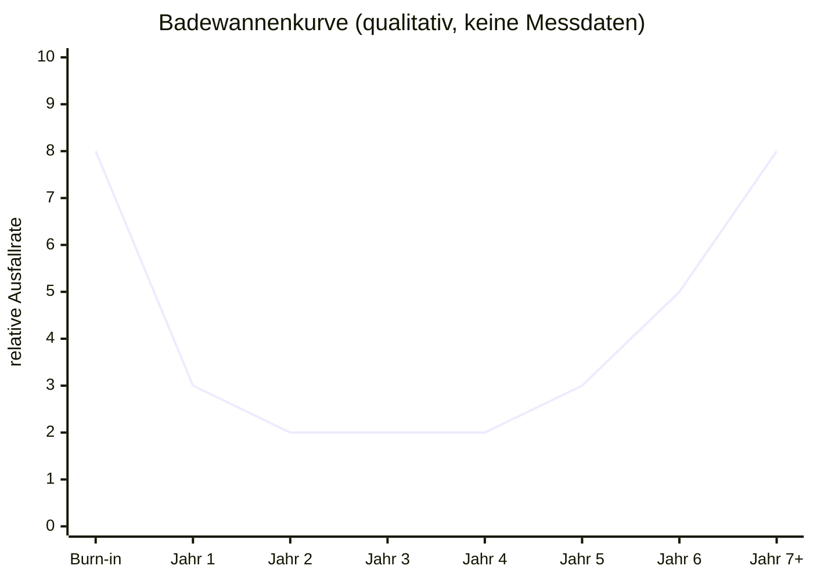
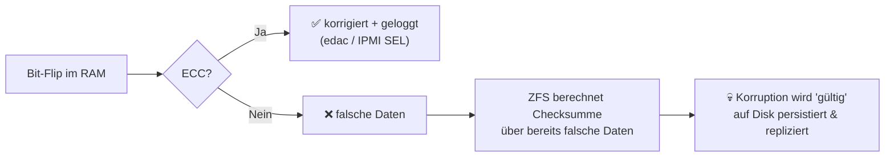
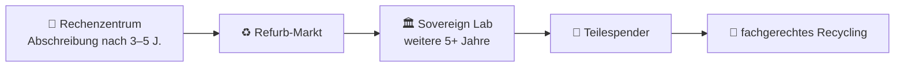

# 🏗️ Warum Enterprise-Hardware? – Zuverlässigkeit, ECC-Mathematik, TCO & Anti-Obsoleszenz

> Zurück zur [README](../README.md) · [Architektur](architecture.md) · [Reality Check](reality-check.md) · 📄 [Referenz-PDF](reference/SM-2026TT-SPEC-V1_supermicro-2026tt-red-team-cluster-hardware-spec.pdf)

> [!IMPORTANT]
> Alle Kosten- und Leistungswerte in den TCO-Tabellen sind **Annahmen** (🅰️-markiert) oder **Schätzungen** (≈). Es sind **keine gemessenen Werte** dieses Clusters. Ersetze sie durch deine echten Zahlen (Stromrechnung, Messsteckdose, Preisrechner des Cloud-Anbieters).

## 📚 Inhalt

1. [MTBF und AFR – was die Zahlen wirklich bedeuten](#-mtbf-und-afr)
2. [ECC-Mathematik: SECDED-Hamming](#-ecc-mathematik-secded-hamming)
3. [Wie oft kippen Bits wirklich? Feldstudien](#-wie-oft-kippen-bits-wirklich)
4. [TCO: Eigenes Metall vs. Cloud](#-tco-eigenes-metall-vs-cloud)
5. [Anti-Obsoleszenz](#️-anti-obsoleszenz)
6. [Quellen](#-quellen)

---

## ⏱️ MTBF und AFR

**MTBF** (*Mean Time Between Failures*) ist eine statistische Grösse für eine **Population** von Geräten während ihrer **Nutzungsphase** (flacher Teil der „Badewannenkurve“) – keine Lebensdauer-Garantie für ein einzelnes Gerät.

Unter Annahme einer konstanten Ausfallrate λ = 1/MTBF (Exponentialverteilung):

$$
\text{AFR} = 1 - e^{-\frac{8760\,\text{h}}{\text{MTBF}}} \approx \frac{8760}{\text{MTBF}} \quad (\text{für MTBF} \gg 8760\,\text{h})
$$

| MTBF (Datenblatt) | AFR (berechnet) | Bedeutung bei 24 Disks (voll bestückt) |
|---|---|---|
| 500'000 h | ≈ 1,74 % | ≈ 0,42 erwartete Ausfälle/Jahr |
| 1'000'000 h | ≈ 0,87 % | ≈ 0,21 /Jahr |
| 1'400'000 h | ≈ 0,62 % | ≈ 0,15 /Jahr |
| 2'000'000 h | ≈ 0,44 % | ≈ 0,10 /Jahr |



### 🔬 Datenblatt vs. Realität

- **Schroeder & Gibson (USENIX FAST 2007)** – ~100'000 Disks: Die beobachteten jährlichen **Austauschraten** lagen typischerweise bei **2–4 %**, teils bis **13 %**, während Datenblatt-MTBFs von 1–1,5 Mio. h nur **0,58–0,88 %** implizieren. Zudem kein ausgeprägtes „flaches“ Mittelstück – Ausfallraten stiegen früh an.
- **Backblaze Drive Stats** (laufend publiziert): Flotten-AFRs je nach Modell grob im Bereich **< 1 % bis mehrere %** – stark modellabhängig.
- **Konsequenz für diesen Cluster:** Gebrauchte Disks (z. B. die Seagate Constellation ES auf NODE 3) haben unbekannte Vorgeschichte → `smartctl -a`, `Power_On_Hours`, `Reallocated_Sector_Ct` prüfen; Redundanz + Backups statt Vertrauen.

### 🔌 Was Enterprise-Hardware konkret besser macht

| Komponente | Enterprise-Merkmal | Effekt auf Verfügbarkeit |
|---|---|---|
| Netzteile | Redundant (N+1), hot-swap, PMBus | Ein PSU-Ausfall → kein Ausfall; Tausch im Betrieb (2 Spare-Module vorhanden ✅) |
| Lüfter | Redundante, überwachte Chassis-Lüfter | BMC alarmiert, bevor es heiss wird |
| Disks | Hot-Swap-Caddies (MCP-220-00047-0B) | Tausch ohne Downtime |
| Nodes | Hot-plug Nodes (Twin) | Node-Wartung bei laufenden Nachbarn |
| RAM | Registered ECC, SDDC (laut SuperMicro für X8DTT: x4/x8 SDDC) | Korrigiert Einzelbitfehler, erkennt Doppelbitfehler; SDDC toleriert Ausfall eines DRAM-Chips |
| BMC/IPMI | Sensoren, SEL-Log, KVM-over-IP | Fehlerdiagnose & Rettung ohne physischen Zugang |

```bash
ipmitool -I lanplus -H <<IPMI_IP>> -U <<USER>> -E sdr elist     # Sensoren (Passwort via IPMI_PASSWORD env)
ipmitool -I lanplus -H <<IPMI_IP>> -U <<USER>> -E sel list      # System Event Log (inkl. ECC-Events)
edac-util -v      # Linux EDAC: korrigierte/unkorrigierte Speicherfehler pro DIMM (Paket edac-utils)
```

---

## 🧮 ECC-Mathematik: SECDED-Hamming

### 1️⃣ Wie viele Prüfbits braucht man?

Für **Single Error Correction** muss das Syndrom aus *r* Prüfbits jede der *k + r* Bitpositionen **plus** „kein Fehler“ unterscheiden können:

$$
2^r \geq k + r + 1
$$

Für ein 64-Bit-Datenwort: r = 7 ⇒ 2⁷ = 128 ≥ 64 + 7 + 1 = 72 ✅ (r = 6 ⇒ 64 < 71 ❌).

Ein **zusätzliches Gesamtparitätsbit** erweitert SEC zu **SECDED** (*Single Error Correct, Double Error Detect*):

$$
64 \text{ Datenbits} + 7 \text{ Hamming-Bits} + 1 \text{ Paritätsbit} = 72 \text{ Bit} \;\Rightarrow\; \text{Hamming}(72,64)
$$

Darum hat ein ECC-DIMM **72 statt 64 Datenleitungen** (typisch 9 statt 8 Chips pro Rank bei x8-DRAMs) – **12,5 % Overhead**.

### 2️⃣ Wie wird korrigiert?

| Syndrom S | Gesamtparität P | Diagnose | Aktion |
|---|---|---|---|
| 0 | korrekt | ✅ kein Fehler | – |
| ≠ 0 | falsch | ⚠️ **1-Bit-Fehler** an Position S | Bit invertieren → **CE** (Corrected Error), geloggt |
| ≠ 0 | korrekt | 🛑 **2-Bit-Fehler** | Nicht korrigierbar → **UE** (Uncorrected Error) → Machine Check, i. d. R. Kernel-Panic statt stiller Korruption |
| 0 | falsch | ⚠️ Fehler im Paritätsbit selbst | Paritätsbit korrigieren |

**Mini-Beispiel (Hamming(7,4), Prinzip identisch):** Datenbits `1011` → Prüfbits an Positionen 1, 2, 4. Kippt Bit 5 beim Lesen, ergibt die Neuberechnung der Prüfbits das Syndrom `101₂ = 5` → Bit 5 wird zurückgekippt. Genau dieser Mechanismus läuft im Speichercontroller für jedes 64-Bit-Wort in Hardware.

### 3️⃣ Warum das für ZFS & VMs relevant ist



> ZFS schützt Daten **auf Disk und auf dem Transportweg** – aber nicht vor Fehlern, die **vor** der Checksummenbildung im RAM entstehen. ECC und ZFS ergänzen sich. (ZFS läuft auch ohne ECC; das oft zitierte „Scrub of Death“-Szenario gilt als übertrieben – ECC bleibt dennoch die richtige Wahl für einen 24/7-Hypervisor.)

### 4️⃣ RDIMM vs. Consumer-UDIMM

| | **ECC RDIMM** (dieser Cluster) | Consumer Non-ECC UDIMM |
|---|---|---|
| Fehlerkorrektur | SECDED, plattformabhängig SDDC/Chipkill | Keine (DDR5 „on-die ECC“ schützt nur intern im Chip, nicht den Bus) |
| Register/Buffer | Adress-/Steuerleitungen gepuffert → mehr DIMMs/Ranks pro Kanal | Ungepuffert → weniger Kapazität |
| Kapazität pro Node | bis 192 GB (X8DTT, Herstellerangabe) | Desktop-Plattformen typischerweise deutlich weniger |
| Gebrauchtpreis DDR3 RDIMM | Sehr niedrig (Rückläufer aus Rechenzentren) | – |
| Fehler-Telemetrie | EDAC, BMC-SEL | Meist keine |

---

## 📊 Wie oft kippen Bits wirklich?

| Studie | Umfang | Kernergebnis |
|---|---|---|
| **Schroeder, Pinheiro, Weber – „DRAM Errors in the Wild“, SIGMETRICS 2009** (Google-Flotte) | Grosse Teile der Google-Serverflotte, ~2,5 Jahre | **25'000–70'000 Fehler pro Milliarde Device-Stunden pro Mbit** (FIT/Mbit); **> 8 % der DIMMs** und **~⅓ der Maschinen** pro Jahr mit mind. einem korrigierbaren Fehler; Fehlerraten **stark korreliert** und von **Hard Errors** dominiert; Alter erhöht Raten |
| **Sridharan & Liberty (SC 2012) / Sridharan et al. (ASPLOS 2015)** | DOE-Supercomputer (Jaguar, Cielo, Hopper) | Grossteil der Fehler auf wenige fehlerhafte Geräte konzentriert; Bedeutung von Chipkill |
| **Meza et al. – „Revisiting Memory Errors…“, DSN 2015** (Facebook) | Gesamte Flotte, 14 Monate | Fehler konzentriert auf wenige Server; höhere Dichte/mehr Kerne korrelieren mit mehr Fehlern |

### ⚠️ Warum man die Rate **nicht naiv** hochrechnen darf

Naive Rechnung für **400 GB** dieses Clusters:

$$
400\,\text{GB} = 400 \times 1024 \times 8 = 3'276'800\ \text{Mbit}
$$

$$
3'276'800\ \text{Mbit} \times \frac{25'000 \ldots 70'000}{10^{9}\ \text{h}} \approx 82 \ldots 229\ \text{Fehler pro Stunde}
$$

Das klingt dramatisch – **ist aber irreführend**: Der Mittelwert wird von wenigen defekten DIMMs mit Tausenden Fehlern dominiert, während die **meisten DIMMs gar keine** Fehler zeigen. Die didaktisch korrekte Aussage lautet:

> 🎯 Bei einer Flotte deiner Grösse (≈ 34–50 DIMMs, je nach Modulgrösse) ist es laut Google-Daten **plausibel, dass pro Jahr mindestens ein DIMM korrigierbare Fehler zeigt** (> 8 % der DIMMs/Jahr ⇒ Erwartungswert ≈ 3–4 DIMMs bei 34–50 Modulen – **Schätzung** übertragen auf eine andere Flotte, Alter und Generation). ECC macht diese Fehler **sichtbar und harmlos**, und `edac-util` sagt dir, welches DIMM du tauschen solltest.

---

## 💰 TCO: Eigenes Metall vs. Cloud

### 🧾 Annahmen (alle explizit, alle austauschbar)

| ID | Annahme | Wert | Kommentar |
|---|---|---|---|
| 🅰️1 | Strompreis | **0,28 CHF/kWh** | **Annahme.** Tarife in FL/CH variieren nach Netzbetreiber und Jahr – eigene Rechnung einsetzen |
| 🅰️2 | Mittlere Leistungsaufnahme Cluster inkl. Switches | **700 W** (≈ Schätzung) | Mit Messsteckdose ersetzen; PDF nennt **> 1'200 W Peak** unter Volllast inkl. GPUs |
| 🅰️3 | Kaufpreis Server (gebraucht) | **800 CHF** (Platzhalter) | **Nicht aus dem PDF** – echten Kaufpreis einsetzen |
| 🅰️4 | Ausbau Phasen 1–3 | **692–936 CHF** | **Aus dem PDF** (171–255 + 271–281 + 250–400 CHF); Rechnung nutzt Obergrenze 936 |
| 🅰️5 | Ersatzteil-Reserve | **150 CHF/Jahr** | Disks, Lüfter, DIMMs (gebraucht) |
| 🅰️6 | Cloud-Compute „vergleichbar“ | **1,80 CHF/h** | **Hypothetischer** On-Demand-Preis für ~32 moderne vCPU / ~384 GB RAM. Mit offiziellem Preisrechner prüfen! |
| 🅰️7 | Leistungs-Normalisierung | 96 Westmere-Threads ≈ **~32 moderne vCPU** | **Grobe Annahme** (Faktor ~⅓); Westmere-Kerne sind pro Takt deutlich langsamer und ohne AVX |
| 🅰️8 | Cloud-Block-Storage | **0,08 CHF/GB/Monat** × 2'048 GB | Hypothetisch |
| 🅰️9 | Cloud-GPU | **0,80 CHF/h** × 4 h/Tag | Hypothetisch, eine Mittelklasse-GPU |
| 🅰️10 | Rabatt bei Commitment (1–3 Jahre) | **−50 %** auf Compute | Hypothetisch; reale Rabatte variieren |
| 🅰️11 | Egress, Arbeitszeit, Miete | **0** | Bewusst ausgeklammert (siehe Fairness-Hinweise) |

### 🧮 Rechenweg

```
Strom/Jahr   = P[kW] × 8760 h × Preis       = 0,7 × 8760 × 0,28 = 6'132 kWh × 0,28 ≈ 1'717 CHF
Compute/Jahr = 1,80 CHF/h × 8760 h          ≈ 15'768 CHF  (On-Demand)   | ≈ 7'884 CHF (−50 %)
Storage/Jahr = 0,08 × 2048 × 12             ≈ 1'966 CHF
GPU/Jahr     = 0,80 × 4 × 365               ≈ 1'168 CHF
```

### 📋 3-Jahres-Vergleich (24/7-Lab, Beispielrechnung)

| Posten | 🏛️ Sovereign (eigenes Metall) | ☁️ Cloud On-Demand | ☁️ Cloud Commitment (−50 %) |
|---|---:|---:|---:|
| Hardware-Kauf (🅰️3) | 800 | – | – |
| Ausbau Phase 1–3 (🅰️4, Obergrenze) | 936 | – | – |
| Strom 3 J. (🅰️1, 🅰️2) | ≈ 5'151 | – | – |
| Ersatzteile 3 J. (🅰️5) | 450 | – | – |
| Compute 3 J. (🅰️6) | – | ≈ 47'304 | ≈ 23'652 |
| Storage 3 J. (🅰️8) | – (lokal) | ≈ 5'898 | ≈ 5'898 |
| GPU 3 J. (🅰️9) | – (eigene GPUs) | ≈ 3'504 | ≈ 3'504 |
| **Summe 3 Jahre (CHF)** | **≈ 7'337** | **≈ 56'706** | **≈ 33'054** |

### ⚖️ Sensitivität & Fairness

| Szenario | Effekt |
|---|---|
| ⚡ Strompreis 0,35 statt 0,28 CHF/kWh | Strom 3 J. ≈ 6'439 CHF → Sovereign ≈ 8'625 CHF |
| 🔥 Dauer-Peak 1'200 W statt 700 W | Strom 3 J. ≈ 8'830 CHF (0,28) → Sovereign ≈ 11'016 CHF |
| 🕐 **Teilzeit-Lab** (10 h/Woche, Cluster sonst **aus**) | Cloud-Compute nur ≈ 2'808 CHF/3 J. – Cloud wird **deutlich** konkurrenzfähiger; Storage-Kosten bleiben |
| 👷 Arbeitszeit | Nicht eingerechnet – Wartung kostet Zeit (ist hier aber auch Lernziel) |
| 🛡️ SLA / Geo-Redundanz | Cloud bietet beides; ein einzelnes Chassis in Schaan nicht |
| 🔊 Lärm/Wärme | 2U-Twin ist laut; Abwärme im Winter evtl. nützlich, im Sommer Kühllast |

> 📌 **Fazit (ehrlich):** Bei **dauerhafter Last**, **viel RAM** und **lokalen Daten** gewinnt eigenes Metall in diesem Modell klar. Bei **sporadischer Nutzung** schrumpft der Vorteil stark. Die grösste Unsicherheit ist 🅰️7: alte Kerne sind nicht gleich neue vCPUs.

---

## ♻️ Anti-Obsoleszenz

| Prinzip | Wie dieser Cluster es lebt |
|---|---|
| 🔩 **Standard-Teile** | DDR3-RDIMMs, 2.5"-SAS/SATA, SFP+, ATX-Stecker für externe GPU-PSUs – alles gebraucht verfügbar |
| 🧰 **Reparierbarkeit** | Hot-swap PSUs/Disks/Nodes, Ersatz-PSUs bereits vorhanden, Teile aus Schlachtgeräten (z. B. GTX 1080 Ti aus HP OMEN 880 laut PDF) |
| 🐧 **Software-Langlebigkeit** | Linux-Kernel & Debian unterstützen Westmere weiterhin (Debian amd64-Baseline = x86-64 v1) |
| 📉 **Bewusste Grenzen** | Distributionen heben Baselines an: z. B. RHEL 9 verlangt **x86-64-v2** (Westmere ✅), RHEL 10 verlangt **x86-64-v3** (AVX2 → Westmere ❌). Langfristig auch für Proxmox/Debian im Auge behalten |
| ⚡ **Energie-Ehrlichkeit** | Ab einem gewissen Strompreis amortisiert sich eine effizientere Plattform. Rechne regelmässig: *Stromkosten alt − Stromkosten neu* vs. *Anschaffung neu* |
| 🎓 **Wissen statt Wegwerfen** | Wer NUMA, IOMMU und ECC an alter Hardware verstanden hat, kann jede neue Plattform beurteilen |



---

## 📖 Quellen

1. B. Schroeder, E. Pinheiro, W.-D. Weber: *DRAM Errors in the Wild: A Large-Scale Field Study.* ACM SIGMETRICS 2009.
2. B. Schroeder, G. Gibson: *Disk failures in the real world: What does an MTTF of 1,000,000 hours mean to you?* USENIX FAST 2007.
3. V. Sridharan, D. Liberty: *A Study of DRAM Failures in the Field.* SC 2012 · V. Sridharan et al.: *Memory Errors in Modern Systems.* ASPLOS 2015.
4. J. Meza, Q. Wu, S. Kumar, O. Mutlu: *Revisiting Memory Errors in Large-Scale Production Data Centers.* IEEE/IFIP DSN 2015.
5. Backblaze: *Hard Drive Stats* (laufende Quartalsberichte), backblaze.com/blog.
6. R. W. Hamming: *Error Detecting and Error Correcting Codes.* Bell System Technical Journal, 1950.
7. SuperMicro: X8DTT-Serie / SYS-2026TT Manuals & Produktseiten (12 DIMM-Slots, SDDC, PCIe 2.0 x16).
8. OpenZFS Documentation – openzfs.github.io.
